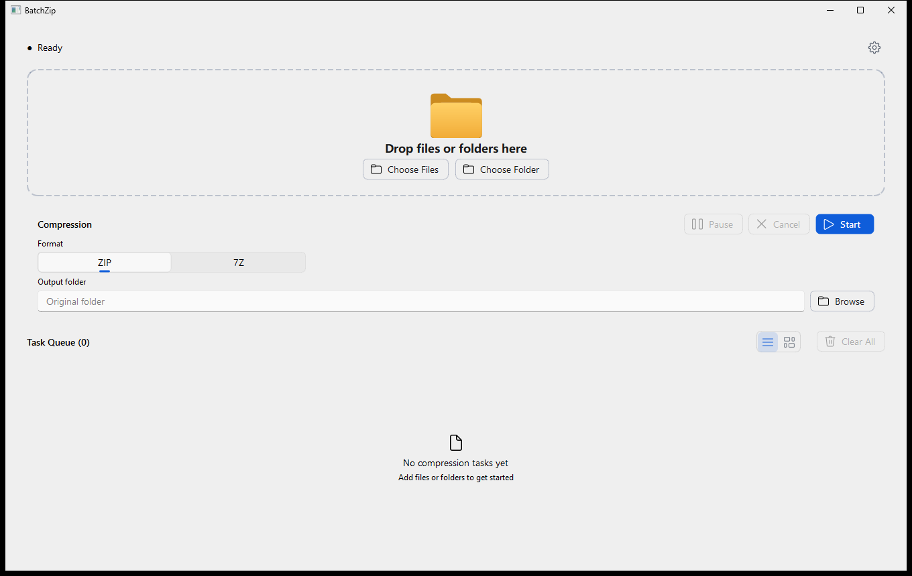
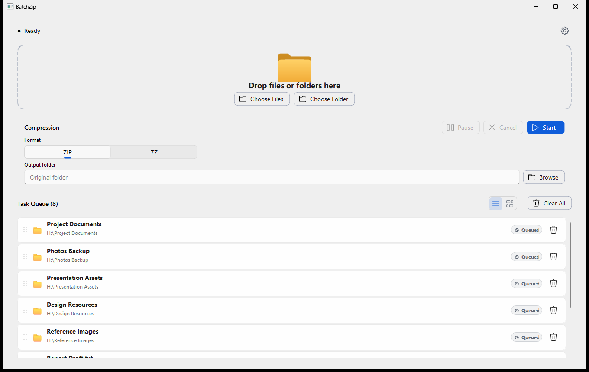

<p align="center">
  
</p>

# BatchZip

<p align="center">
  <b>Compress multiple files and folders. Manage everything in one queue.</b>
</p>

<p align="center">
  <a href="https://github.com/KAKAzere/BatchZip/releases">
    
  </a>
</p>

BatchZip is a Windows batch compression tool built around a simple, manageable
task queue. Add files and folders once, choose ZIP or 7Z, and watch the whole
batch finish without touching a command line.

---

## Features

**Batch compression**
Add many files and folders to a single queue and let it run.

**ZIP and 7Z**
Create either format, switching whenever you like.

**Queue management**
Reorder queued tasks, remove what you no longer need, and see status at a glance.

**Pause, resume and cancel**
Stay in control of a running compression instead of waiting it out.

**List and Grid views**
Switch between a compact list and a card grid, with drag-and-drop reordering in both.

**Appearance settings**
System, Light or Dark. Your choice is remembered between sessions.

---

## Screenshots

<p align="center">
  
  
</p>

<p align="center">
  <sub>BatchZip 1.0.0-rc5 — Home screen and task queue.</sub>
</p>

---

## Quick start

1. Download the latest release from the [releases page](https://github.com/KAKAzere/BatchZip/releases).
2. Make sure [7-Zip](https://www.7-zip.org/) is installed — BatchZip uses it to do the actual compression.
3. Add files or folders by dragging them onto the window, or with the buttons in the drop area.
4. Pick ZIP or 7Z and choose where the archives should go.
5. Press Start, then pause, resume or cancel as needed.

---

## Requirements

- Windows 10 or Windows 11
- [7-Zip](https://www.7-zip.org/) installed

BatchZip does not bundle, redistribute or embed 7-Zip. It locates an existing
installation through `PATH`, the Windows registry, or the standard install
directories, and calls it as an external tool. 7-Zip is a separate product by
Igor Pavlov under its own license.

Running from source additionally needs Python 3.14 with the packages in
`requirements.txt`.

---

## Output naming

BatchZip never overwrites an existing archive. If `report.zip` already exists,
the next archive is written as `report (2).zip`, then `report (3).zip`, and so on.

---

## Run from source

```powershell
git clone https://github.com/KAKAzere/BatchZip.git
cd BatchZip
python -m venv .venv
.\.venv\Scripts\Activate.ps1
python -m pip install -r requirements.txt
python main.py
```

To build the Windows executable:

```powershell
.\build.bat
```

The executable is written to `dist\BatchZip.exe`. Release builds are produced
with an isolated virtual environment and locked dependencies.

---

## Technology

Python · PySide6 · PySide6-Fluent-Widgets · 7-Zip · PyInstaller

---

## Project status

Current development version: **1.0.0-rc5**, not yet published.

Development notes for each candidate are in the [`releases`](releases) directory.
The automated suite currently covers 167 tests, all passing.

---

## License

BatchZip is an independent open-source project distributed under the [MIT License](LICENSE).

Copyright (c) 2026 Kaka.

## Third-Party Software — 7-Zip

BatchZip uses [7-Zip](https://www.7-zip.org/) as an external compression backend for creating ZIP and 7Z archives.

**7-Zip is not included with BatchZip.** BatchZip does not bundle, embed, modify, or redistribute any 7-Zip executables, libraries, source code, or other components.

Users must download and install 7-Zip separately from its [official website](https://www.7-zip.org/). BatchZip detects and invokes the installed 7-Zip application to perform compression operations.

7-Zip is developed by Igor Pavlov and is licensed independently of BatchZip. Most of its code is distributed under the GNU Lesser General Public License (LGPL), while certain components use the BSD 2-Clause or BSD 3-Clause licenses or are subject to an unRAR license restriction. See the [official 7-Zip license information](https://www.7-zip.org/license.txt) for details.

The MIT License governing BatchZip applies only to BatchZip and does not replace or modify the licensing terms of 7-Zip.

BatchZip is an independent project and is not an official 7-Zip application.